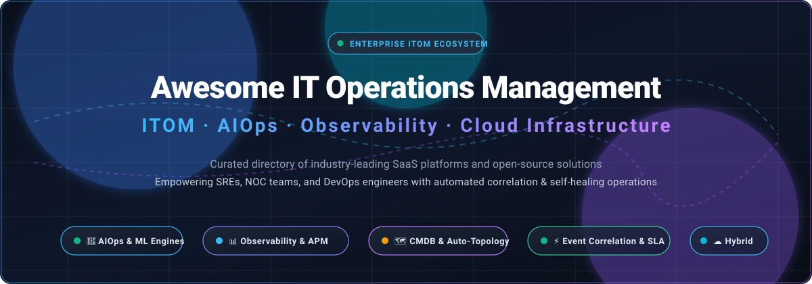

<div align="center">



# 🚀 Awesome IT Operations Management (ITOM)

<a href="https://github.com/ishandutta2007/Awesome-Awesome-Awesome"></a><a href="https://discord.gg/jc4xtF58Ve"></a><a href="https://github.com/ishandutta2007/Awesome-IT-Operations-Management-ITOM/stargazers"></a><a href="https://github.com/ishandutta2007/Awesome-IT-Operations-Management-ITOM/network/members"></a><a href="https://github.com/ishandutta2007/Awesome-IT-Operations-Management-ITOM/pulls"></a><a href="https://github.com/ishandutta2007/Awesome-IT-Operations-Management-ITOM/blob/main/LICENSE"></a><a href="https://github.com/ishandutta2007"></a>

**Curated directory of premier SaaS platforms, open-source projects, AIOps frameworks, and observability solutions for enterprise IT Operations Management (ITOM).**

</div>

---

## 📑 Table of Contents
- [📖 Overview & SEO Focus](#-overview--seo-focus)
- [🌐 Sector Overview & Market Dynamics](#-sector-overview--market-dynamics)
- [💼 Enterprise SaaS ITOM Platforms](#-enterprise-saas-itom-platforms)
- [💻 Open-Source ITOM & Observability Projects](#-open-source-itom--observability-projects)
- [🏗️ Reference ITOM Architectural Framework](#-reference-itom-architectural-framework)
- [🤝 How to Contribute](#-how-to-contribute)
- [💖 Support & Sponsorship](#-support--sponsorship)
- [⭐ Star History](#-star-history)
- [⚖️ Disclaimer](#-disclaimer)

---

## 📖 Overview & SEO Focus

**IT Operations Management (ITOM)** encompasses the administrative processes, monitoring practices, and automation tooling used to oversee IT infrastructure, application services, cloud resources, and network provisioning. Modern ITOM relies heavily on **AIOps (Artificial Intelligence for IT Operations)**, **telemetry event correlation**, **full-stack observability (APM, metrics, logs, traces)**, **CMDB asset topology**, and **automated self-healing remediation** to maximize service uptime, reduce Mean Time to Resolution (MTTR), and streamline digital transformation across hybrid and multi-cloud environments.

This repository tracks the leading **commercial SaaS solutions** and **open-source GitHub projects** empowering Site Reliability Engineers (SREs), Network Operations Center (NOC) teams, and IT leadership worldwide.

---

## 🌐 Sector Overview & Market Dynamics

> 📊 **Market Valuation & Growth**: The global IT Operations Management (ITOM) software market reached **$36.3B – $51.7B between 2024 and 2026**, expanding at a compound annual growth rate (**CAGR of 8.0% – 12.1%**), with projections exceeding **$69B+ by 2030** fueled by multi-cloud complexity, telemetry data explosion, and generative AIOps workflows.
>
> 🧩 **Market Fragmentation**: The sector exhibits **moderate fragmentation with top-heavy consolidation**. While legacy and hyperscale titans (ServiceNow, Cisco/Splunk, Datadog) command dominant revenue shares in core enterprise CMDB, ITSM, and enterprise-wide telemetry, the broader ecosystem remains vibrant and fragmented across specialized APM, network monitoring, and edge-native observability vendors, preventing a single winner-take-all monopoly.

---

## 💼 Enterprise SaaS ITOM Platforms

Below is the comparative breakdown of premier enterprise ITOM suites, sorted in **descending order by company size and market valuation**:

| 🏢 Platform / Product | 📈 Company Size / Valuation | ⚙️ Key Capabilities & ITOM Highlights | 💵 Starting Pricing | 🎁 Free Tier / Trial Limits |
| :--- | :--- | :--- | :--- | :--- |
| **[Cisco AppDynamics](https://www.appdynamics.com/)** | **~$415B Market Cap** *(Parent: Cisco Systems, FY25 Rev: $53.8B; AppDynamics acquired for $3.7B)* | Real-time APM, full-stack infrastructure correlation, end-to-end business transaction tracking, automated root cause diagnostics, and SAP visibility. | **$6.00 / month per CPU core** *(Infrastructure Monitoring Edition; Premium APM starts at $33.00/core/month)* | **30-Day Free Trial** (Full SaaS controller capabilities; post-trial defaults to 1 active agent per language runtime) |
| **[Splunk ITSI & Observability Cloud](https://www.splunk.com/)** | **$28.0B Acquisition Valuation** *(Acquired by Cisco in 2024; Splunk annual revenue ~$3.8B)* | IT Service Intelligence (ITSI 5.0) with Event iQ alert clustering, predictive KPI analytics, ServiceNow CMDB bi-directional sync, and microservice tracing. | **$15.00 / host / month** *(Splunk Observability Cloud Infrastructure; ITSI workloads from $0.15/vCPU-hr)* | **Free Forever** for up to **15 hosts** (Full platform metrics, traces & OpenTelemetry ingest) or **14-day** full Enterprise trial |
| **[ServiceNow ITOM](https://www.servicenow.com/)** | **~$162B Market Cap** *(FY25 Revenue: $13.28B, TTM Revenue: $14.7B)* | Comprehensive Now Platform suite: Service Graph CMDB, Metric Intelligence, Health Log Analytics, Event Management, and automated self-healing runbooks. | **~$0.50 – $1.50 / node / month** *(ITOM Subscription Unit model; standard enterprise packages typically start ~$30–$58/node/year)* | **Free Forever Personal Developer Instance (PDI)** (Full-stack dedicated instance via developer.servicenow.com with 10-day refresh) or **15-Day** Enterprise Sandbox |
| **[Datadog](https://www.datadoghq.com/)** | **~$48B Market Cap** *(FY25 Revenue: ~$2.6B)* | Unified cloud monitoring, APM, synthetic testing, network device monitoring, Watchdog AI anomaly detection, and out-of-the-box integrations for 800+ tech stacks. | **$15.00 / host / month** *(Pro tier billed annually; Enterprise tier at $23.00/host/month)* | **Free Forever** for up to **5 hosts** with 1-day metric retention; **14-Day Free Trial** with full APM, trace, and log capabilities |
| **[Dynatrace](https://www.dynatrace.com/)** | **~$13.5B Market Cap** *(FY25 Revenue: ~$1.4B)* | Davis AI engine for deterministic and agentic root cause analysis, automated topology discovery (Smartscape), Kubernetes observability, and cloud automation. | **$0.04 / hour per 8 GiB host** *(~$29.00 / 8 GiB host / month for Infrastructure Monitoring; Full-Stack APM at $0.08/hr)* | **15-Day Free Trial** (Includes 200,000 Davis Data Units, 50,000 RUM sessions, and 30,000 synthetic web checks; no credit card required) |
| **[BMC Helix Operations Management](https://www.bmc.com/)** | **~$8.5B Valuation** *(Acquired by KKR; Annual Revenue: ~$2.0B+)* | Enterprise AIOps platform with centralized operational data lake, multivariate event correlation, dynamic service modeling, and automated remediation. | **£5.25 – £8.10 (~$6.80 – $10.50) / resource unit / month** *(Official UK G-Cloud framework list pricing for ITOM/AIOps)* | **30-Day Proof-of-Concept (PoC)** (Full enterprise multi-cloud AIOps deployment sandbox provisioned upon request) |
| **[New Relic](https://newrelic.com/)** | **$6.5B Valuation** *(Acquired by Francisco Partners & TPG; Annual Revenue: ~$1.0B)* | Telemetry Data Platform with Service Architecture Intelligence (SAI), NRQL Predictions, distributed tracing, and out-of-the-box infrastructure agents. | **$0.40 / GB** beyond free allowance + **$49.00 / month** per Core User (*$99.00/mo per Full Platform user*) | **Free Forever** includes **100 GB/month data ingestion**, 1 Full Platform User, unlimited basic users, 500 synthetic checks/mo, and 8-day retention |
| **[SolarWinds Observability](https://www.solarwinds.com/)** | **$4.4B Enterprise Valuation** *(Acquired by Turn/River Capital in 2025; Annual Revenue: ~$780M)* | Cross-stack hybrid management for networks, virtualization, storage, and cloud (AWS/Azure); application dependency mapping and capacity forecasting. | **$7.42 – $8.00 / node / month** *(Self-Hosted Essentials billed annually; SaaS APM starts at $27.00/service/month)* | **30-Day Free Trial** (Full enterprise feature access including 10 GB/day log quota; reverts to restricted Lite mode post-trial) |
| **[LogicMonitor](https://www.logicmonitor.com/)** | **~$2.4B Valuation** *(Backed by Vista Equity Partners & PSG Golub Capital)* | Automated agentless hybrid cloud monitoring, Edwin AI noise reduction agents, LM Uptime, and Dynamic Service Insights across on-prem and edge gear. | **$16.00 / Hybrid Unit / month** *(Essentials tier; Advanced tier at $27.00/HU/mo; Signature + Edwin AI at $53.00/HU/mo)* | **14-Day Free Trial** (Full access to core monitoring, automated discovery, and Edwin AI across test hybrid units) |
| **[ScienceLogic SL1](https://sciencelogic.com/)** | **~$1.0B+ Valuation** *(Backed by Silver Lake Waterman, Goldman Sachs & Intel Capital)* | Skylar AIOps platform for hybrid infrastructure; automatic discovery, misconfiguration detection, CMDB sync, and policy-driven remediation runbooks. | **$5.00 / device / month** *(Skylar One Standard tier; Skylar One Advanced from $6.00 – $20.00/device/month)* | **14-Day Test Drive / Free Trial** (Interactive hands-on sandbox environment with full AIOps and automated root cause analysis) |

---

## 💻 Open-Source ITOM & Observability Projects

Open-source ITOM solutions empower organizations to build sovereign, license-free, and vendor-neutral monitoring, telemetry, and incident management pipelines. The projects below are **sorted in descending order by GitHub stars**:

1. **[Uptime Kuma](https://github.com/louislam/uptime-kuma)** [](https://github.com/louislam/uptime-kuma/stargazers)  
   Lightweight, self-hosted uptime monitoring dashboard supporting HTTP(s), TCP, Ping, DNS, Docker container checks, and status pages with 90+ notification channels.
2. **[Netdata](https://github.com/netdata/netdata)** [](https://github.com/netdata/netdata/stargazers)  
   Real-time, zero-configuration infrastructure monitoring agent with per-second metrics, pre-trained edge machine learning anomaly detection, and 800+ collector plugins.
3. **[Grafana](https://github.com/grafana/grafana)** [](https://github.com/grafana/grafana/stargazers)  
   The industry-standard open visualization and analytics platform for querying, visualizing, alerting on, and exploring metrics, logs, and traces across diverse data sources.
4. **[Prometheus](https://github.com/prometheus/prometheus)** [](https://github.com/prometheus/prometheus/stargazers)  
   Cloud Native Computing Foundation (CNCF) graduated systems monitoring and alerting toolkit featuring a pull-based dimensional metrics model and PromQL query language.
5. **[Glances](https://github.com/nicolargo/glances)** [](https://github.com/nicolargo/glances/stargazers)  
   Cross-platform curses- and web-based system monitoring tool written in Python, offering real-time hardware telemetry and RESTful API endpoints.
6. **[SigNoz](https://github.com/SigNoz/signoz)** [](https://github.com/SigNoz/signoz/stargazers)  
   Open-source APM and observability platform natively powered by OpenTelemetry and ClickHouse; combines distributed traces, metrics, and logs in a unified UI.
7. **[Jaeger](https://github.com/jaegertracing/jaeger)** [](https://github.com/jaegertracing/jaeger/stargazers)  
   CNCF graduated distributed tracing system for tracking complex transaction flows across microservices, root cause discovery, and latency profiling.
8. **[VictoriaMetrics](https://github.com/VictoriaMetrics/VictoriaMetrics)** [](https://github.com/VictoriaMetrics/VictoriaMetrics/stargazers)  
   High-performance, cost-effective, and scalable time series database (TSDB) and long-term storage monitoring solution compatible with Prometheus PromQL.
9. **[Ansible AWX](https://github.com/ansible/awx)** [](https://github.com/ansible/awx/stargazers)  
   Open-source web UI, REST API, and task engine for Ansible playbooks; serves as the orchestration backbone for automated configuration management and remediation.
10. **[OpenSearch](https://github.com/opensearch-project/OpenSearch)** [](https://github.com/opensearch-project/OpenSearch/stargazers)  
    Community-driven, open-source search and analytics suite derived from Elasticsearch, ideal for centralized log management, trace analytics, and SIEM security telemetry.
11. **[Keep](https://github.com/keephq/keep)** [](https://github.com/keephq/keep/stargazers)  
    Open-source AIOps and alert management framework that deduplicates alerts from multiple monitoring tools, enriches events with AI, and automates incident triage.
12. **[OpenTelemetry Collector](https://github.com/open-telemetry/opentelemetry-collector)** [](https://github.com/open-telemetry/opentelemetry-collector/stargazers)  
    Vendor-agnostic proxy agent designed to receive, process, transform, and export telemetry data (traces, metrics, logs) across heterogeneous IT environments.
13. **[Zabbix](https://github.com/zabbix/zabbix)** [](https://github.com/zabbix/zabbix/stargazers)  
    Enterprise-class distributed monitoring solution for networks, servers, virtual machines, and cloud services, with auto-discovery and agentless polling.
14. **[Rundeck](https://github.com/rundeck/rundeck)** [](https://github.com/rundeck/rundeck/stargazers)  
    Runbook automation engine that enables self-service IT operations, scheduled routine maintenance, and automated incident remediation workflows.
15. **[LibreNMS](https://github.com/librenms/librenms)** [](https://github.com/librenms/librenms/stargazers)  
    Autodiscovering PHP/SNMP network monitoring system providing cross-platform hardware health tracking, interface billing, and custom alerting.
16. **[Robusta](https://github.com/robusta-dev/robusta)** [](https://github.com/robusta-dev/robusta/stargazers)  
    Kubernetes-native observability and automated incident response platform that monitors clusters, enriches alerts with contextual debugging data, and auto-fixes crashes.
17. **[Checkmk](https://github.com/Checkmk/checkmk)** [](https://github.com/Checkmk/checkmk/stargazers)  
    Comprehensive infrastructure and application monitoring platform with thousands of built-in check plugins, low CPU overhead, and rule-based configuration.
18. **[Alerta](https://github.com/alerta/alerta)** [](https://github.com/alerta/alerta/stargazers)  
    Scalable alert aggregation console with deduplication, rule-based routing, heartbeat daemon, and rich REST API for modern incident operations.
19. **[Icinga 2](https://github.com/Icinga/icinga2)** [](https://github.com/Icinga/icinga2/stargazers)  
    High-performance, modular network monitoring tool offering multi-threaded check execution, graph generation, and flexible rule-based event handlers.
20. **[ManageIQ](https://github.com/ManageIQ/manageiq)** [](https://github.com/ManageIQ/manageiq/stargazers)  
    Hybrid IT management and cloud management platform (CMP) providing CMDB asset discovery, compliance enforcement, workload optimization, and orchestration.
21. **[AutoOps (天枢)](https://github.com/opsre/AutoOps)** [](https://github.com/opsre/AutoOps/stargazers)  
    Enterprise-grade IT operations automation framework written in Go & Vue 3; integrates CMDB asset management, multi-cloud jump servers, task scheduling, and K8s orchestration.

---

## 🏗️ Reference ITOM Architectural Framework

Organizations seeking a best-of-breed, vendor-neutral ITOM deployment can assemble a sovereign stack combining specialized open-source layers:

```
┌─────────────────────────────────────────────────────────────┐
│                 📊 Unified Visualization                     │
│                Grafana / OpenSearch Dashboards              │
└──────────────────────────────┬──────────────────────────────┘
                               │
┌──────────────────────────────┴──────────────────────────────┐
│             🤖 AIOps, Correlation & Alert Routing           │
│                 Keep  /  Alerta  /  Robusta                 │
└──────────────────────────────┬──────────────────────────────┘
                               │
┌──────────────────────────────┴──────────────────────────────┐
│           📈 Telemetry, Time-Series & Log Storage           │
│        Prometheus  /  VictoriaMetrics  /  OpenSearch        │
└──────────────────────────────┬──────────────────────────────┘
                               │
┌──────────────────────────────┴──────────────────────────────┐
│           🌐 Telemetry Ingestion & Real-Time Collection      │
│      OpenTelemetry Collector  /  Netdata  /  Glances         │
└──────────────────────────────┬──────────────────────────────┘
                               │
┌──────────────────────────────┴──────────────────────────────┐
│           ⚡ Automated Remediation & CMDB Governance         │
│          Ansible AWX  /  Rundeck  /  AutoOps  /  ManageIQ    │
└─────────────────────────────────────────────────────────────┘
```

---

## 🤝 How to Contribute

Contributions are welcome and appreciated! To maintain the highest quality:

1. 🍴 Fork the repository.
2. 🌿 Create a feature branch: `git checkout -b feature/add-new-itom-platform`.
3. 📝 Update `README.md` following the established formatting, table structure, or star badge conventions.
4. ✅ Ensure data accuracy, official links, transparent pricing, and neutral descriptive wording.
5. 🚀 Submit a Pull Request with a clear description of the addition.

---

## 💖 Support & Sponsorship

If you find this ITOM directory valuable for your engineering team, architecture design, or vendor selection, please consider supporting the project:

- ⭐ **Star this repository** to help others discover it!
- 🍴 **Fork and share** with your DevOps, NOC, and SRE colleagues.
- ☕ **Buy a coffee or become a sponsor**: Support ongoing research, updates, and maintenance via the **[GitHub Sponsors Dashboard](https://github.com/sponsors/ishandutta2007)**!

Your support keeps this curated ecosystem independent, up-to-date, and community-driven! 🙏

---

## ⭐ Star History

[](https://star-history.dera.page/#ishandutta2007/Awesome-IT-Operations-Management-ITOM&type=date&legend=top-left)

---

## ⚖️ Disclaimer

- This curated list is maintained for educational and reference purposes; inclusion does not constitute a formal commercial endorsement.
- All product names, logos, and brands are property of their respective owners.
- ITOM platforms process sensitive operational metrics, configurations, and logs; organizations must verify compliance with GDPR, HIPAA, SOC 2, and internal data security policies.
